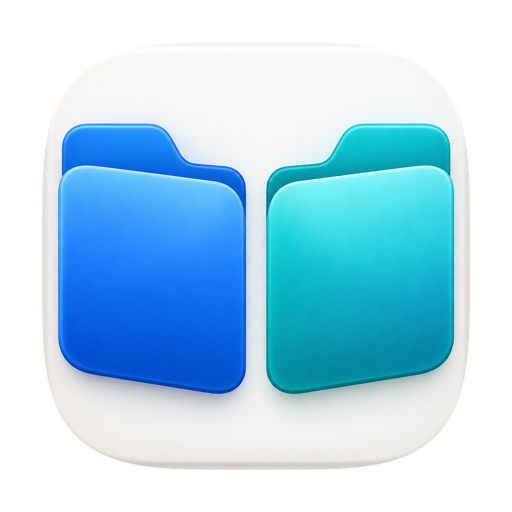

# PKPane



macOS 向けの2ペインファイルマネージャーです。左右にフォルダを並べ、ローカル、外付けドライブ、ネットワーク上のファイルを閲覧・整理・転送できます。Swift 6、SwiftUI、AppKit で開発しています。

PKPane is a dual-pane file manager for macOS. It browses, organizes, and transfers files across local disks, external drives, and network servers (SMB, SFTP, FTP/FTPS).

現在は開発段階です。正式配布前であり、日常利用に向けた検証を続けています。重要なファイルを扱う場合はバックアップを用意し、まず複製したデータでお試しください。

## 主な機能

- 左右のペイン、リスト・アイコン・カラム表示、キーボード操作
- コピー・移動・削除、一括リネーム、Finder タグの表示・編集
- 転送キュー、進捗表示、フォルダ比較・同期
- ファイル検索、プレビュー、アーカイブの作成・展開、ZIP 内の閲覧
- SMB、SFTP、FTP、明示的 FTPS への接続とファイル操作
- SFTP の踏み台接続と、`~/.ssh/config` から選択した接続設定の読み込み
- お気に入り、最近の項目、接続先の管理、ワークスペースの復元
- Quick Open、パターンによる選択、左右ペインの連動ブラウズ、Git 状態の表示
- 外観（システム・ライト・ダーク・クリーム）、キーボードショートカットの変更、日本語・英語表示

使える操作は接続先やファイルシステムによって異なります。クラウドストレージは、各サービスの公式 macOS アプリが提供する File Provider のフォルダを通して扱います。クラウドサービス独自 API への直接接続は行いません。

## 動作環境

- Apple Silicon 搭載 Mac
- macOS 15 以降

現在のビルド対象は `arm64` です。Intel Mac は対象外です。

## 開発環境とビルド

Swift 6 と `swift format` が使える Xcode、XcodeGen 2.45.4 以降が必要です。Xcode のコマンドラインツールを利用できる状態にしてください。初回の依存パッケージ取得にはネットワーク接続が必要です。

確認済みの開発環境は Xcode 27.1（Build 27A9275）、Apple Swift 6.4、XcodeGen 2.46.0 です。これ以前の Xcode でのビルドは確認していません。

リポジトリのルートで Xcode プロジェクトを生成して開きます。

```sh
./scripts/generate_project.sh
open PKPane.xcodeproj
```

`PKPane` スキームを選んでビルド・実行してください。プロジェクト設定の正本は `project.yml` です。生成された `.xcodeproj` は Git 管理外で、変更は再生成時に上書きされます。

### ローカルの署名設定

Xcode から開発署名で実行する場合は、自分の開発チームを `Config/Signing.local.xcconfig` に指定できます。このファイルは Git 管理外です。

```xcconfig
DEVELOPMENT_TEAM = YOUR_TEAM_ID
```

`YOUR_TEAM_ID` を自分の Team ID に置き換え、Xcode の「Signing & Capabilities」で証明書とプロビジョニング設定を確認してください。署名や権限の条件によって利用できる機能が変わります。

## 開発者向けの検証

`scripts/check_all.sh` は、Swift の厳格な整形チェック、Xcode プロジェクト生成、依存パッケージ解決、Debug ビルドをまとめて行います。

```sh
./scripts/check_all.sh
```

単体テストは次のコマンドで実行します。

```sh
./scripts/check_all.sh --test
```

対象を絞る場合は、スイート名を指定します。

```sh
./scripts/check_all.sh --only-testing PKPaneTests/LocalFileProviderTests
```

これらのコマンドは整形チェックも行います。実行前後に、この作業ディレクトリの Debug アプリとテストランナーを終了するため、作業中の転送がない状態で実行してください。`--test` は単体テスト用で、UI テストや実サーバーを使う接続テストは別途実行する必要があります。

`check_all.sh` のビルドとテストは ad-hoc 署名と検証用の権限設定を使います。成功しても、開発署名・配布署名での Sandbox 動作は確認できません。

## 不具合報告・開発への協力

不具合を報告する際は、macOS のバージョン、アプリのバージョンまたはコミット、接続方式、再現手順、期待した結果と実際の結果を添えてください。修正案には、変更の目的と検証に使ったコマンド・結果があると確認しやすくなります。

ログやスクリーンショットを共有する前に、パスワード、秘密鍵、トークン、ユーザー名、接続先アドレス、ファイル名・パスなどの個人情報や機密情報を伏せてください。実データを含まない最小の再現例を推奨します。

## ライセンス

アプリ本体は [MIT License](LICENSE) で公開しています。依存ライブラリには、それぞれのライセンスが適用されます。

依存ライブラリのライセンス原文と NOTICE は [同梱ライセンス](PKPane/ThirdPartyLicenses/) を参照してください。
